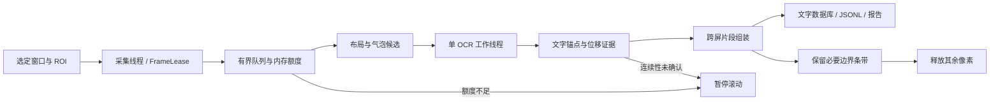

# WeLog：内存 OCR、气泡边界与跨屏补全改造方案

后续实现与实际验证见 [内存 OCR 实现记录](memory-ocr-implementation.md)。本文保留最初源码研究与设计背景。

本次交付是固定提交的源码审计、纯算法离线复现和改造设计。没有操作微信窗口，没有初始化第三方 OCR 模型，也没有把第三方实现接入现有运行流程。

结论：保留 WeLog 的用户选窗、区域校准、稳定检测、滚轮事件规划和方向记录；借鉴 `wechatOcr` 的数组 OCR、消息区域分类与保守状态建模，借鉴 `Weclip` 的颜色校准和双向序列重叠思路。截图存储、内存背压、文字定位和跨屏消息组装需要重新设计，不能直接拼装这两个项目。

## 1. 研究版本和复现材料

| 项目 | 固定提交 | 研究重点 |
|---|---|---|
| [yaozhwen/wechatOcr](https://github.com/yaozhwen/wechatOcr/tree/b2cde637550e1406f15887cd7bc32e6f6c5716c2) | `b2cde637550e1406f15887cd7bc32e6f6c5716c2` | `capture.py`、`recognition.py`、`tracking.py`、`gui.py` 和相关测试 |
| [yuanzal/Weclip](https://github.com/yuanzal/Weclip/tree/d3aa61d521b36ae9ad6081e86c163aa1cf6ecd7f) | `d3aa61d521b36ae9ad6081e86c163aa1cf6ecd7f` | `ocr_core.py`、GUI、入口与依赖 |

源码快照位于 `research/sources/`，下载文件逐一验证 Git blob SHA；清单是 [source-manifest.json](../research/source-manifest.json)。快照目录已排除版本控制，不向项目源码直接引入第三方模块。

两个固定快照都没有独立 LICENSE 文件，GitHub 元数据也未识别许可证。本方案以算法研究和独立实现为主；直接复制代码或分发前需先确认授权。

离线复现只编译白名单 AST 定义，排除模块导入时的 PaddleOCR 初始化、GUI 和窗口控制代码。结果见 [probe-results.json](../research/probe-results.json)，复现脚本是 [probe_upstream.py](../research/probe_upstream.py)。这不是完整运行两个软件，也不是实际 OCR 准确率评测。

## 2. wechatOcr：值得借鉴的结构和实际边界

### 2.1 数组 OCR 路径成立，但整个程序尚无严格内存上限

`WgcSession` 回调复制窗口缓冲区，底层只留 `latest`；`read_lines` 把 RGB 数组转换为 BGR，直接调用 RapidOCR，模型以单实例缓存。实时路径不需要临时图片。前后台身份检查、DPI/窗口尺寸失效处理和模型懒加载都值得参考。[窗口采集](https://github.com/yaozhwen/wechatOcr/blob/b2cde637550e1406f15887cd7bc32e6f6c5716c2/wechat_ocr/capture.py#L89)、[数组 OCR](https://github.com/yaozhwen/wechatOcr/blob/b2cde637550e1406f15887cd7bc32e6f6c5716c2/wechat_ocr/recognition.py#L248)

不过，它不是“所有数据都有界”：GUI 的两条队列使用默认无容量上限的 `queue.Queue()`，事件载荷包含 RGB 数组；`Collector.segments` 累积全部消息和帧元数据；GUI 还保留原图、标注图和预览。`read_lines` 默认把整块输入放大两倍，像素数量变为四倍。我们可以借鉴数组接口，不能照搬队列与缓存策略。[GUI 队列](https://github.com/yaozhwen/wechatOcr/blob/b2cde637550e1406f15887cd7bc32e6f6c5716c2/wechat_ocr/gui.py#L109)

还要区分实时识别和文件模式：其 CLI 截图模式会保存 JSON 和标注 PNG，GUI 有显式保存标注图入口。WeLog 的严格不落盘模式不应继承这些图像写入入口。

### 2.2 气泡分组合理，但完整性只有一个布尔值

`find_bubbles` 使用浅灰/绿色背景连通区域，结合外侧对齐边和头像推断方向。`content_regions` 统一文本、图片和分享卡片；`prepare_ocr` 遮去已确认媒体、头像和引用预览，避免图片内部文字混入聊天正文。[气泡检测](https://github.com/yaozhwen/wechatOcr/blob/b2cde637550e1406f15887cd7bc32e6f6c5716c2/wechat_ocr/recognition.py#L110)、[识别前遮罩](https://github.com/yaozhwen/wechatOcr/blob/b2cde637550e1406f15887cd7bc32e6f6c5716c2/wechat_ocr/recognition.py#L195)

限制是：

- 使用固定浅色阈值，只能作为当前主题的基线。
- `complete` 只表示是否接触上下边缘，没有分别描述顶部、底部可见性。
- 高度超过视口 85% 的气泡被过滤。合成含文字长气泡实验中，它随后被 `content_regions` 分类为图片，可能在 OCR 前被遮掉。
- 完整文字气泡若没有 OCR 行，会直接跳过；这对完整导出不够，应输出识别失败状态。
- 语音时长通过文字正则过滤，可能误伤用户真实发送的类似文本，需要正向媒体图标证据。

### 2.3 Collector 是保守片段合并，不是跨屏气泡补全

`Collector.signature` 包含完整文字、完整性、方向、发送者、类型和媒体指纹。主重叠分支寻找“旧列表尾部＝新列表头部”，适合向下浏览；不实现向上浏览所需的反向重叠，也不会把截断文字升级为同一消息的完整版本。[Collector](https://github.com/yaozhwen/wechatOcr/blob/b2cde637550e1406f15887cd7bc32e6f6c5716c2/wechat_ocr/tracking.py#L52)

离线复现：向下 `[甲,乙]→[乙,丙]` 得到一个片段、三条记录；向上 `[乙,丙]→[甲,乙]` 得到两个片段、四条记录。截断版本变为完整版本时也形成两条记录。它这样做是保守保留证据，我们需要在此之上增加真正的片段组装器。

媒体可见像素 SHA256 能辅助判断静态图片，但动态图每帧变化，不宜成为消息身份的必要条件。其 `FrameGate` 用整片区域像素差做稳定判断，局部动画模拟中六次均未就绪；不要替换我们现有的局部动态容忍策略。[FrameGate](https://github.com/yaozhwen/wechatOcr/blob/b2cde637550e1406f15887cd7bc32e6f6c5716c2/wechat_ocr/tracking.py#L12)

## 3. Weclip：颜色校准可参考，存储和去重不能直接使用

### 3.1 内存入口内部仍然写图片

`_run_ocr_on_bgr` 先把整图写入临时 PNG；`_run_ocr_on_file` 又为每个气泡写临时 PNG，再交给模型。关闭 debug 也不能消除这些写入；GUI 的 debug 默认还是开启的。[临时整图](https://github.com/yuanzal/Weclip/blob/d3aa61d521b36ae9ad6081e86c163aa1cf6ecd7f/ocr_core.py#L368)、[逐气泡临时图](https://github.com/yuanzal/Weclip/blob/d3aa61d521b36ae9ad6081e86c163aa1cf6ecd7f/ocr_core.py#L245)、[GUI 默认配置](https://github.com/yuanzal/Weclip/blob/d3aa61d521b36ae9ad6081e86c163aa1cf6ecd7f/gui_app.py#L76)

多屏路径先把所有截图放进 `captures` 列表，采完才逐帧 OCR；调试长图使用不断 `vstack` 的增长数组。因此内存随页数增长，不能采用为流式主路径。[多屏采集](https://github.com/yuanzal/Weclip/blob/d3aa61d521b36ae9ad6081e86c163aa1cf6ecd7f/ocr_core.py#L498)、[批量识别](https://github.com/yuanzal/Weclip/blob/d3aa61d521b36ae9ad6081e86c163aa1cf6ecd7f/ocr_core.py#L655)

### 3.2 气泡几何过滤会丢掉目标场景

`_extract_bubbles_from_mask` 过滤高度超过视口 40% 的块，并直接过滤顶部贴边气泡。底部截断块可能保留，但没有完整性标记。[过滤逻辑](https://github.com/yuanzal/Weclip/blob/d3aa61d521b36ae9ad6081e86c163aa1cf6ecd7f/ocr_core.py#L181)

它的交互采色和 HSV 容差值得借鉴；但低饱和度灰色不能依赖固定色相。合成中性灰气泡实验中，默认白色掩码没有选中任何像素，需要按当前主题重新校准。[颜色掩码](https://github.com/yuanzal/Weclip/blob/d3aa61d521b36ae9ad6081e86c163aa1cf6ecd7f/ocr_core.py#L153)

### 3.3 去重会吞掉真实聊天，不能作为消息身份判定

序列重叠确实同时尝试 prepend/append，可参考其方向处理思路。但后续处理用发送者和规范化文字作为键，折叠相邻重复，并删除最近 20 条内再次出现的同键消息；没有可靠重叠时还会检查整个已合并列表的键。[合并入口](https://github.com/yuanzal/Weclip/blob/d3aa61d521b36ae9ad6081e86c163aa1cf6ecd7f/ocr_core.py#L767)、[重复折叠](https://github.com/yuanzal/Weclip/blob/d3aa61d521b36ae9ad6081e86c163aa1cf6ecd7f/ocr_core.py#L904)

离线复现中，单张图内两条独立的“好”变成一条；`好、明天见、好` 丢掉最后一条；`下午三点开会、下午三点开会取消` 也被合并。我们只应合并同一消息的多次观察，不按语义相似或文本相同删除消息。

它的滚动流程同样依赖图像重叠门控，失败会反向微调，直接迁入会保留我们正在解决的回退问题。

## 4. 离线复现摘要

| 构造场景 | wechatOcr | Weclip |
|---|---|---|
| 普通气泡 | 检出 | 检出 |
| 顶部截断 | 保留、`complete=false` | 直接过滤 |
| 高度占视口 48% | 检出 | 直接过滤 |
| 底部截断 | 保留、`complete=false` | 可保留，但无截断状态 |
| 高度占视口 88% 的文字气泡 | 气泡过滤后被分类为图片 | 直接过滤 |
| 向上翻页重叠 | 新开片段，重复记录 | 有 prepend 分支，但去重过度 |
| 真实重复文字 | 倾向保留不确定片段 | 会删除合法重复 |
| 部分文字变完整 | 两条记录，没有补全 | 不能可靠证明为同一气泡 |

以上是控制变量算法实验，不等于所有真实主题和图片的识别表现。没有调用远程模型、没有加载 OCR 权重、没有生成截图文件。

## 5. 对现有 WeLog 的改动位置

| 当前模块 | 现状 | 改造 |
|---|---|---|
| [windows.py](../src/welog/windows.py) | 已返回 BGR 数组；抓取整屏后裁剪，保留 `last_frame` | 保留选窗门控，尽量原生采集 ROI 与标题的联合区域；明确缓冲区所有权和释放 |
| [controller.py](../src/welog/controller.py) | `Archive` 与像素配准是硬依赖；失败触发反向恢复 | 改为有界任务协调器；文字锚点为主要证据，匹配失败不直接驱动反向输入 |
| [archive.py](../src/welog/archive.py) | 每帧和诊断帧无条件保存 PNG | 实时默认改为仅元数据的会话日志，图像只在内存池里 |
| [gui.py](../src/welog/gui.py) | 采完自动调用依赖 PNG 的回放 | 改为结构化消息与指标报告，去掉实时流程对图片目录的依赖 |
| [replay.py](../src/welog/replay.py) | 回放会复制原始图像到新目录 | 保留旧归档兼容工具；新增文字观察记录重放，不为新会话生成图片回放 |
| [CoordinateTracker](../src/welog/replay.py) | 保存一份完整 BGR 参照图 | 新模式主要保存文字锚点、局部特征和条带；短期像素引用统一纳入 lease，不独立复制整页 |
| [models.py](../src/welog/models.py) | 只有几何、配准和控制参数 | 增加帧、文字行、边界状态、气泡片段和消息实体 |

本轮不替换稳定工作的 DXcam，不迁入 Tkinter。WGC 可作为后续可选适配器，不能与这次消息完整性改造捆绑成前置工程。

## 6. 目标数据流：内存有界，模型串行，输入受背压控制

第一版固定一个 OCR 工作线程，模型初始化一次。使用 `RapidOcrAdapter.recognize(bgr_array) -> list[TextLine]` 这样的项目内接口，调用 RapidOCR 的数组入口，返回原生 ROI 坐标。仅在需要时放大局部文字块，记录缩放变换，不能每帧盲目复制两倍整屏。

线程分工：采集线程独占窗口与 DXcam 对象；OCR 线程不接触窗口；GUI 只接收状态、计数和文字结果，不在事件队列里传递全尺寸截图。暂停、会话变化和关闭使用 `session_epoch` 取消旧任务，参考 wechatOcr 的代次设计。

允许 OCR 与下一页采样重叠执行，但最多保留一个尚未验证的跨页过渡。下一次滚动前必须已有上一页可消费的快照，并且有图像额度；未确认过渡超限就停在原位，不丢未处理帧，也不无限向前积压。

### 6.1 明确“截图不落盘”的边界

禁止原图、气泡裁剪、条带、拼接图、异常诊断图通过 PNG/JPEG、临时文件、base64 JSON 等方式保存。错误路径也必须遵守。模型权重和用户选择输出的结构化文字不属于截图。

把当前 `Archive` 从实时主路径移出，使用 `MetadataJournal` 写帧编号、时间、布局代次、滚轮动作、OCR 状态、配准状态、释放状态和缺口；不保存像素。图像证据只保留内存生命周期内的 `FrameLease` 或边界条带。

历史归档继续作为离线测试输入，不自动删除用户已有数据。新会话报告显示文字、帧号、位置、完整性、缺口和指标，不再提供原图回放。需要重新核对原图的能力会因此减少，不能假装仍能事后重建所有画面。

### 6.2 可执行的内存预算

- 待处理队列最多两帧，单 OCR 任务；同时使用字节额度，不能只限制帧数。
- 应用持有的截图、灰度样本、条带和显式拼接缓冲区先设 64 MiB 额度，分配/复制前申请；不足时等待或降低后续步长。
- OCR 引擎权重、推理工作区和采集后端原生缓冲另行测量，不把“缓存 64 MiB”宣称为整个进程的内存上限。
- 当前 977×724 的 BGR ROI 约 2.02 MiB；四份完整 ROI 约 8.1 MiB，三个灰度样本约 2.0 MiB，两条 1/3 高度条带约 1.35 MiB。整图放大与颜色转换还会产生额外副本，必须计入工作区规划。
- `FrameLease` 用引用计数或明确 owner 管理生命周期；边界条带必须独立 `copy`。单纯保留 numpy 切片可能仍钉住整张原图。
- 完整 OCR 和必要条带提取完成后释放原图；跨缝补识别结束再释放旧条带。没有历史整图列表，不构建无限长截图。
- 消息与帧元数据流式写入 SQLite/JSONL，GUI 仅保留最近一段，避免复制 `Collector.segments` 的无限增长。

释放引用和复用缓冲不保证进程 RSS 立即下降。验收关注缓存是否有界、资源是否最终释放，以及 RSS 是否在长时间运行后进入平台。

## 7. 气泡起止识别：边界证据与 OCR 成功分开

先做布局候选，再识别文字。统一内部使用 BGR uint8 和原生像素；OCR/布局的框统一为右下不包含的 XYXY，现有采集 `Rect(x,y,width,height)` 只在接口处转换。

检测流程：

1. 在已校准 ROI 中估计背景和双方气泡色；低饱和度颜色主要比较亮度与色差，不要求固定色相。
2. 结合连通区域、轮廓、左右对齐、头像候选和气泡周围间隙提出消息块。
3. 去掉按高度比例过滤长气泡的规则；顶部贴边、底部贴边不是丢弃理由。
4. 对大块中性背景保留文字候选，不能仅因大而分类为图片。图片、卡片、动态图需要正向视觉证据；无法判断时保留 unknown。
5. 已确认媒体不送入正文 OCR；其内部文字不作为聊天正文或时间锚点。正文内的小表情不能导致整条文字气泡被遮掉。
6. OCR 行框归属到候选气泡，按阅读顺序合并；完整气泡 OCR 失败也保留 `ocr_failed` 观察，不静默删除。

边界分别记录：

| 字段 | 取值 | 意义 |
|---|---|---|
| `top_state` | visible / clipped / uncertain | 是否看见真实顶部边界及外围背景 |
| `bottom_state` | visible / clipped / uncertain | 是否看见真实底部边界及外围背景 |
| `ocr_status` | ok / partial / failed | 与轮廓完整性独立 |
| `coordinate_status` | confirmed / estimated / unknown | 位移是否有可靠证据 |
| `coverage_status` | continuous / gap / unknown | 片段间是否连续 |

触及视口边缘时保守标为 clipped 或 uncertain；观察不到边界就不凭句号、语义或头像猜结束。`complete` 是最终派生结果，要求头尾边界已观察、片段覆盖连续且文字质量可接受。

建议数据对象：`TextLine(text, raw_text, bbox, score)`、`BubbleObservation(id, frame_id, bbox, direction, kind, top_state, bottom_state, lines)`、`MessageFragment` 和独立 UUID 的 `MessageRecord`。发送者显示名与唯一身份分开，OCR 置信度与归属/分类置信度分开。

## 8. 跨屏补全：先证明同一气泡，再补像素和文字

### 8.1 文字锚点与位置

只选高置信度正文行作为主要锚点，避开媒体、昵称、时间标签和裁断行。匹配同时使用文字、横向位置、消息顺序与已知采集方向，多个锚点必须给出一致位移。比较可以规范化空白，但输出保留原文和原始换行。

文字行估计 `ΔS = median(y_previous - y_current)`；OCR 框存在抖动，因此拼接条带前在文字局部区域做小范围像素细对齐。必要时用屏蔽动态区域后的静态特征点作辅助，而不是恢复全图模板硬门控。我们现有动图失败样本已显示静态特征仍可匹配，这适合用作辅助证据。

需要分开两种遮罩：**正文 OCR 遮罩**排除已确认图片、卡片、头像等非正文；**运动估计遮罩**只排除动态图和不可靠区域。静态图片可以仅作为几何辅助，不识别或输出其中的文字。不能把 OCR 的媒体遮罩直接交给位移估计，否则在“静态图片＋动图”的页面上会把可用锚点一起删除。

`global_y = S + roi_y - origin_y` 的约定保留，向上采集 S 为负。无法确认时 `S` 可以为空或明确标为估计，不把滚轮请求量当成真实像素位移。整页坐标不确定不意味着完整可读气泡必须丢弃：可以保存带不确定性标签的观察，跨片段合并仍需另外证明。

### 8.2 双向片段关联

- 向下采集：旧页尾部与新页头部关联。
- 向上采集：新页尾部与旧页头部关联；新发现内容往消息前面补，不按截图时间顺序直接追加。
- 同一片段关联要有横向范围、方向、互补截断边界、文字/几何重叠和邻居顺序证据。
- 两个完整气泡即使同人同文也保持独立 UUID；不采用“最近 20 条按文本去重”，也不把较短句子是较长句子子串当成同一消息。
- 同一观察多次 OCR 可以保存候选并择优，但必须先确认物理归属，不能先按内容合并。

### 8.3 采用三分条带补识别，但不盲拼

初版可以保留上下各 1/3 视口的边界条带，以后按两到四行文字高度自适应缩小。向上扫描时，按自然阅读顺序拼“新发现的上页下段＋旧下页上段”；向下扫描相反。

先根据已确认位移去掉真实重叠、对齐横向坐标，再对跨缝文字重新 OCR。不能把存在重叠的两条带直接堆起来，否则会重复文字；若有像素缺口，则拼接不能补回缺字，应记录 gap/partial。

只重识别受到边界影响的文字行或气泡局部，不重复识别整条历史。上下文用于判定片段归属，不用于补写没有像素证据的文字。

### 8.4 长消息与 PendingMessage

气泡可以跨三屏以上。按块完成正文 OCR，释放旧图，只维护滚动边界条带、已识别文字行和覆盖区间。文字片段可流式写入存储，按逻辑行序或已确认高度组织，不要求整条长气泡同时在内存中。

状态迁移为 `candidate → partial_head/partial_tail/middle → complete`，也可以进入 `needs_review`。只有头尾都出现且覆盖无缺口才完成；停止、超时、会话变化或预算耗尽时把未完成消息输出为 partial，而不是丢弃或猜补。

纯媒体页没有文字锚点时，可在已标定的保守步长下有限向前采样，但不能宣称精确高度已知。若当前有未补全文字，或未验证跨度达到上限，应停在原位。无法证明连续时建立新片段并记录缺口，不通过反向滚动反复碰运气。

## 9. 新增模块与实施顺序

| 顺序 | 模块/修改点 | 可验收交付 |
|---|---|---|
| M0 | `frame_pool.py`、`MetadataJournal`；拆开 `Archive` 和实时 controller | 默认实时路径无任何图像写入，额度/停止/异常释放可验证 |
| M1 | `ocr_backend.py`、`layout.py`、消息模型 | 单张内存图像得到气泡、文字行和独立上下边界状态；OCR 失败不漏掉候选 |
| M2 | `text_alignment.py`、协调器 | 普通帧遵守采集方向，重叠按文字证据校验；动态图不触发自动反向输入 |
| M3 | `assembler.py`、条带重识别 | 向上/向下、半行半字和三屏长消息均可补全，真实重复消息保留 |
| M4 | 文字存储、GUI、报告和离线回归 | 原图释放后仍可导出消息及完整性指标，报告不嵌入图片或 base64 |

先完成 M0 和单张图的 M1，使用模拟 OCR 验证所有权与状态机，再用本地模型验证实际截图。不要同时迁移捕获后端、GUI 框架和 OCR 模型系列。RapidOCR/ONNX Runtime 版本在独立兼容性验证后锁定，不直接照抄两个仓库的依赖列表。

建议内部接口是：`FrameSource.read() -> FrameLease`、`LayoutDetector.detect(bgr) -> observations`、`OcrBackend.recognize(bgr) -> lines`、`TextAligner.link(previous,current,direction) -> evidence`、`FragmentAssembler.consume(...) -> message_updates`。存储接口只接受可序列化文字与元数据，不接受 ndarray。

控制器不再因单次整图匹配失败就反向输入。先原位重识别边界，再减小后续批次；无法保证连续时暂停。OCR 背压和有效重叠仍需保留，不能把“不反向”误实现为不受限制地盲目滚动。

## 10. 验收清单

| 目标 | 必测场景 | 通过条件 |
|---|---|---|
| 零截图落盘 | 正常、OCR 异常、稳定超时、取消、缺口、导出 | 拦截 `cv2.imwrite`、PIL 保存、临时图片和图片字节写入；实时路径无调用、输出无截图 |
| 内存有界 | 连续千帧、慢 OCR、巨大 ROI、长气泡、关闭 | 额度不超限，队列背压有效，条带不引用整图，停止后所有 lease 归还；测量 RSS 平台 |
| 气泡边界 | 顶部/底部/两端截断，40%、85%、超过一屏的气泡 | 候选不被尺寸过滤丢掉，头尾状态独立，OCR 失败有记录 |
| 媒体隔离 | 动图、截图里有字、分享卡片、正文混合表情 | 图片文字不误入正文，动图不做消息身份键 |
| 跨屏补全 | 向上/向下，跨半行、半字、三屏以上消息 | 一条物理消息输出一次，所有有像素证据的文字得到保留；缺口明确标记 |
| 重复消息 | 好/好、好/明天见/好、开会/开会取消 | 完整气泡不因文字相同或子串关系被合并 |
| 控制行为 | 图像匹配失败、文字锚点不足、OCR 落后 | 不自动反向输入，不丢未处理帧，不伪造精确高度 |
| 既有能力 | 当前所有离线方向/恢复/累计高度回归 | 旧归档兼容不退化，新模式不再依赖 PNG 才能运行 |

实际 OCR 质量需另建人工标注的离线截图集，报告字符错误率、整条消息正确率、漏消息率、错误合并率和 partial 数量。模拟 OCR 测试不替代这些指标。

## 11. 推荐的决策

采用 wechatOcr 的数组识别和“先区分消息区域再归属文字”的架构；采用 Weclip 的可校准颜色配置和 prepend/append 思路；独立实现内存额度、边界状态、文字锚点和片段组装器。保留当前工作代码作为可回归的底座，不直接 fork 任一仓库覆盖现有项目。

下一轮最小实现应交付：不落盘的 FrameLease 流水线、RapidOCR 数组适配、浅色私聊气泡检测、上下边界状态、双向跨屏补全文本与保留重复消息的组装器。群成员昵称和复杂引用后置，但数据结构提前预留。
